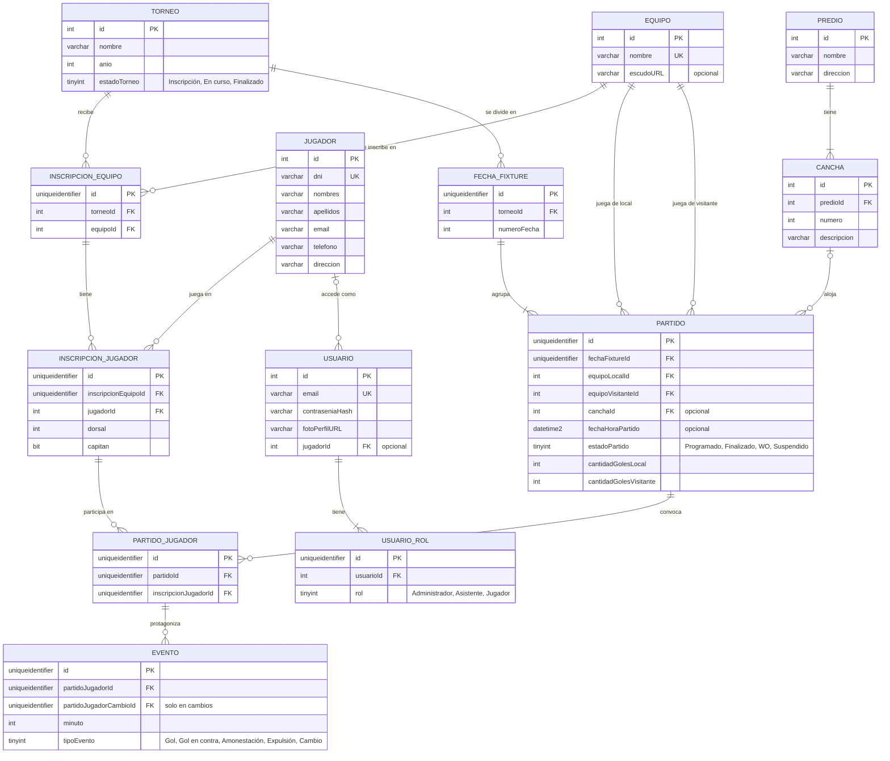

# Propuesta TP DSW

## Grupo
### Integrantes
* 47216 - Rindello, Mateo
* 54666 - Urquiza, Juan

### Repositorios
* [frontend app](https://github.com/mateorindello1/LigaHub-FE)
* [backend app](https://github.com/mateorindello1/LigaHub-BE)

## Tema
### Descripción
LigaHub organiza torneos de fútbol amateur. El administrador da de alta los torneos y los equipos, inscribe los equipos en cada torneo y genera el fixture "todos contra todos" de forma automática. Con los partidos jugados, el sistema calcula la tabla de posiciones y muestra el detalle de cada equipo: sus partidos, sus resultados y sus jugadores.

### Modelo

El diagrama con todas las claves únicas está en el repositorio del backend: [modelo-de-datos.png](https://github.com/mateorindello1/LigaHub-BE/blob/main/docs/modelo-de-datos.png).

### Tecnologías

| Capa                | Tecnología                             |
| :------------------ | :------------------------------------- |
| Lenguaje            | TypeScript (frontend y backend)        |
| Backend             | Node.js 24 con NestJS                  |
| Persistencia        | Prisma (ORM) con SQL Server            |
| Frontend            | React 19 con Vite                      |
| Componentes         | Syncfusion para React, tema Material 3 |
| Datos y formularios | TanStack Query, React Hook Form y Zod  |
| Tests               | Vitest                                 |

## Alcance Funcional

### Alcance Mínimo

Regularidad:

|Req|Detalle|
|:-|:-|
|CRUD simple|1. CRUD Torneo 2. CRUD Equipo|
|CRUD dependiente|1. CRUD Inscripción de equipo {depende de} CRUD Torneo y CRUD Equipo|
|Listado + detalle|1. Tabla de posiciones filtrada por torneo, muestra posición, equipo, partidos jugados, ganados, empatados, perdidos, goles a favor y en contra, diferencia de gol y puntos => detalle del equipo en el torneo: datos del torneo y del equipo, su línea de la tabla, sus partidos (rival, resultado, día y hora, cancha) y sus jugadores inscriptos (dorsal y capitán)|
|CUU/Epic|1. Generar el fixture del torneo automáticamente a partir de los equipos inscriptos ("todos contra todos", con opción de ida y vuelta y fecha de inicio)|

Adicionales para Aprobación:

|Req|Detalle|
|:-|:-|
|CRUD |1. CRUD Torneo 2. CRUD Equipo 3. CRUD Jugador 4. CRUD Predio 5. CRUD Cancha {depende de} CRUD Predio 6. CRUD Inscripción de equipo 7. CRUD Inscripción de jugador {depende de} CRUD Inscripción de equipo y CRUD Jugador|
|CUU/Epic|1. Generar el fixture del torneo automáticamente 2. Cargar el resultado de un partido del fixture: jugadores que participaron y eventos (goles, tarjetas, cambios), con cálculo automático del resultado y actualización de la tabla de posiciones. Usa los partidos que genera el CUU 1|

### Alcance Adicional Voluntario

*Nota*: El Alcance Adicional Voluntario es opcional, pero ayuda a que la funcionalidad del sistema esté completa y será considerado en la nota en función de su complejidad y esfuerzo.

|Req|Detalle|
|:-|:-|
|Listados |1. Goleadores filtrados por torneo, muestra jugador, equipo y goles 2. Fixture filtrado por torneo, muestra cada fecha con sus partidos, resultado, día, hora y cancha|
|CUU/Epic|1. Deshacer el fixture mientras no haya partidos jugados 2. Calcular suspensiones a partir de las tarjetas de cada partido|
|Otros|1. Acceso de los jugadores para consultar y actualizar sus datos|
